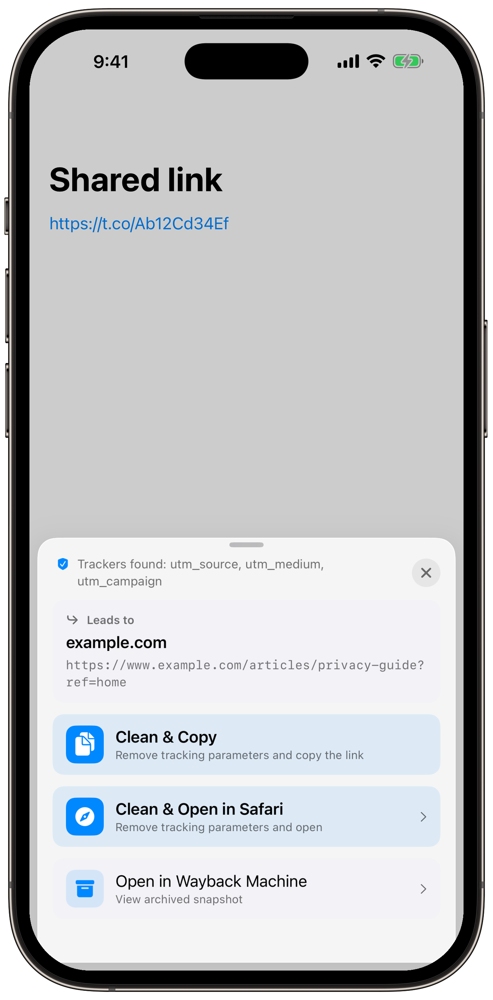
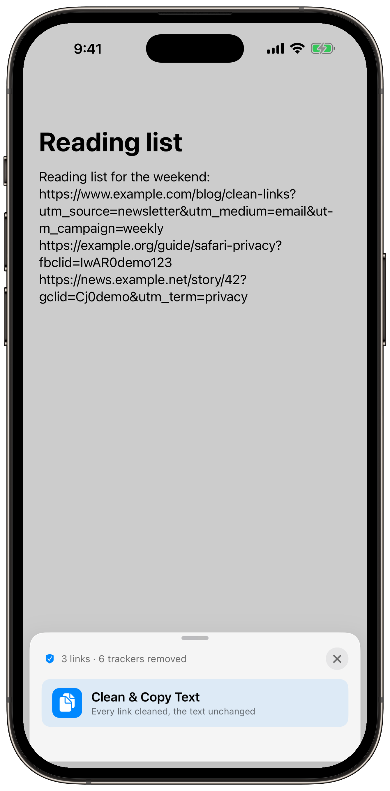
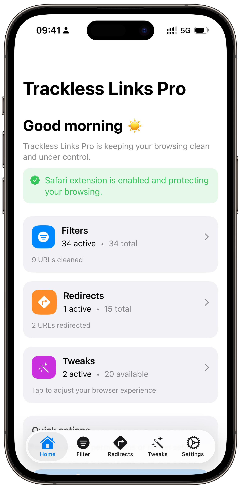
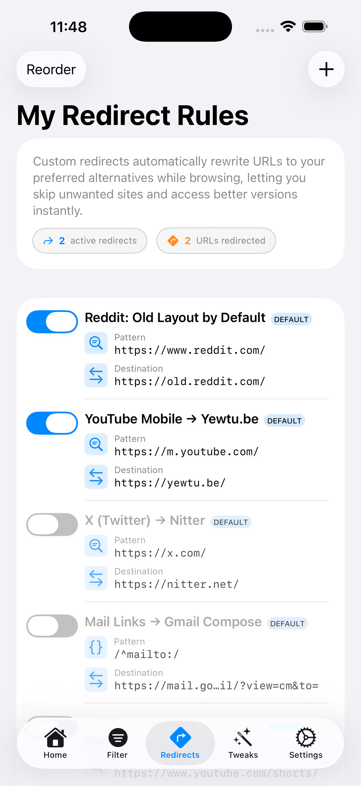
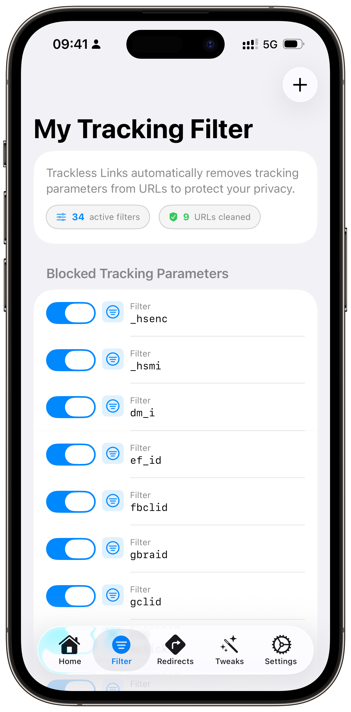
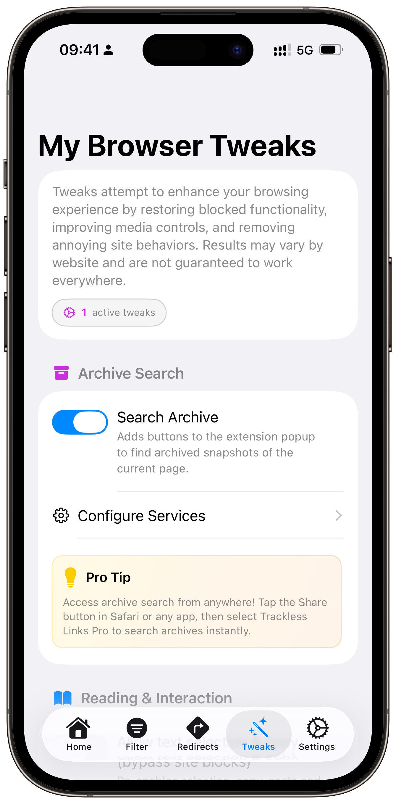

🇺🇸 **English** | 🇩🇪 [Deutsch](README_de.md) | 🇪🇸 [Español](README_es.md) | 🇫🇷 [Français](README_fr.md) | 🇯🇵 [日本語](README_ja.md) | 🇨🇳 [中文](README_zh-Hans.md)

# Trackless Links – Safari Extension for Privacy, URL Cleaning & Tracker Blocking

Already own Trackless Links? The [Upgrade Bundle](https://apps.apple.com/app-bundle/id1850924833) charges only the price difference, not the full price again.

  

**The Safari extension that removes tracking codes, redirects annoying sites, and restores website functionality you've been missing.**

> 📰 **Reviewed in Mac & i 4/2026 (heise).** "Trackless Links is useful for covering your digital tracks and getting around annoying website restrictions" - and, compared to competitor StopTheMadness Pro, "significantly cheaper and easier to use." (Translated from German. Original: "praktisch, um digitale Spuren zu verwischen und lästige Einschränkungen von Websites zu umgehen" / "deutlich günstiger und einfacher zu bedienen".) [Read the review](https://www.heise.de/select/mac-and-i/2026/4/2609012234834091131) (paywalled, German).

Tired of sharing messy URLs full of `?utm_source=...` tracking garbage? Frustrated by websites that block text selection or force autoplay videos? Trackless Links fixes all of this automatically – links are cleaned on your device, with zero data collection.

Built with a clean, modern design, Trackless Links feels light and powerful on iPhone, iPad, and Mac.

---

## 🚀 Download Now

### Trackless Links Pro — Best for Mac Users
**One purchase. iPhone + iPad + Mac.** Full feature set with seamless iCloud sync across all your Apple devices.

### Trackless Links — Best for iPhone & iPad
Complete privacy protection and browsing control for iOS. **iOS only — Mac users need Pro.**

---

## ✨ What Makes Trackless Links Different?

Most "privacy" extensions just block ads. Trackless Links does more – it cleans your URLs, redirects you away from tracking-heavy sites, and fixes broken website behaviors. Links are cleaned entirely on your device, and the app only goes online when you ask it to.

### 🛡️ Automatic Tracker Removal

Stop sharing links that expose your browsing habits.

- **Strips tracking parameters** like `utm_source`, `fbclid`, `gclid`, `mc_eid` from every URL
- **Removes share IDs** like `si` and `igsh` that YouTube, Spotify, Instagram, TikTok, and X add to shared links (optional, off by default)
- **Pre-loaded blocklist** with 50+ common tracking codes
- **Add your own rules** for complete customization
- **Real-time statistics** show exactly how many trackers you've blocked

### 🌐 Open in Safari

Keep links **inside Safari** instead of jumping into the installed app every time you tap one.

- **Per-domain control** — toggle Instagram, X (Twitter), YouTube, TikTok, Reddit, LinkedIn, Pinterest, and Spotify individually
- **Custom domains** — add any site you want to keep in Safari
- **Off by default** — opt in only for the apps that bug you
- Stops the constant context-switch when sharing or browsing links

### 📺 YouTube Picture-in-Picture

Finally on the free tier. Watch any YouTube video in PiP without leaving the page.

- **Auto-PiP**: swipe up to the home screen or lock your device while a YouTube video plays — PiP starts automatically
- **Long-press**: hold a video for about half a second to start PiP on demand
- **Off by default** — enable in **Settings → Tweaks → Enable Picture-in-Picture**

### 🎙️ Siri Shortcuts & Action Button

Clean links hands-free — from the Lock Screen, Action Button, or just by asking Siri.

- **Five ready-to-use actions** — Clean URL, Check Credibility, Clean & Check, Batch Clean, Open in Archive
- **Action Button support** — assign any action to your iPhone's Action Button
- **Shortcuts integration** — combine with other apps in automation workflows
- **Share Sheet** — clean links directly from any app's share menu

### 🍪 Cookie & Consent Banner Blocking

Banners hidden before they even render. No more "Accept All" fatigue.

- **Native Content Blocker** — works at Safari's rendering layer for instant blocking
- **Hundreds of cookie banners covered** — consent popups disappear automatically
- **Auto-reject mode** — clicks "Reject All" where possible
- **Zero page load impact** — faster than JavaScript-based blockers

### 🔀 Smart URL Redirects

Skip annoying sites automatically.

- **Reddit → Old Reddit** – Escape the redesign
- **Twitter/X → XCancel** – Privacy-respecting alternative
- **YouTube → Invidious** – Ad-free viewing
- **Instagram → Imginn** – View without login
- **Google Maps → Apple Maps** – Native maps experience
- **20+ built-in redirects** focusing on privacy and speed
- **Create custom rules** with plain text or regex
- **Drag-and-drop priority** – Your rules, your order

### ⚡ Browser Tweaks That Actually Work

Restore the web functionality that sites try to break.

- **Force text selection** on sites that block copying
- **Enable right-click menus** everywhere
- **Block autoplay videos** across all sites
- **Force Picture-in-Picture** on any video
- **Remove "Are you sure you want to leave?" popups**
- **Apply dark mode** to any website with smart color inversion
- **Lock playback speed** so videos don't reset to 1x
- **Hide "Open App" nags** on Reddit, YouTube, and Instagram, plus "Get Chrome" and "Switch to Edge" banners
- **Pause on this site** when a site misbehaves: no cleaning, tweaks, or banner hiding there until you resume it (paused sites are listed in Settings)

### 🔍 Source Credibility — Know Before You Click

Get warned when visiting sites known for misinformation, fake news, or conspiracy theories.

Unlike commercial blocklists, the data behind these warnings is public. [CRED-1](https://github.com/aloth/cred-1) is an open research dataset ([CC BY 4.0](https://creativecommons.org/licenses/by/4.0/)) built from openly licensed sources, rebuilt weekly, and documented in a [research paper](https://doi.org/10.2139/ssrn.6448466) - so anyone can inspect the scoring, verify a domain, or reuse the dataset. The lookup itself runs entirely on your device; no browsing data is ever sent anywhere.

- **Powered by [CRED-1](https://github.com/aloth/cred-1)** – Open research dataset of 2,600+ flagged domains, presented at ACM WebSci 2026 ([paper](https://doi.org/10.2139/ssrn.6448466))
- **Tiered warning banners** – High risk (red), elevated (orange), moderate (yellow)
- **Dismiss or go back** – One tap to ignore per site or navigate to safety
- **Optional auto-updates** – Keep the bundled CRED-1 dataset aligned with the latest published release
- **100% on-device** – No browsing data sent anywhere
- **Off by default** – Enable when you're ready in the Credibility tab, including auto-updates if you want them

### 📦 Web Archive Search

Find deleted or changed content instantly.

- **One-tap Wayback Machine access** from Safari toolbar
- **Multiple archive services** configurable
- **Smart URL cleaning** for better match rates
- **Works from Share Sheet** in any app

### 📤 Works Everywhere You Browse

- **Share Sheet integration** – Tap **Clean & Copy** to get a tracker-free link on your clipboard, from Reddit, X, email, anywhere (iPhone & iPad). A line above the buttons shows which trackers it removes, that a link is already clean, or that a short link like t.co hides its destination. Tap **Resolve** to see where a t.co, bit.ly, TikTok, or Reddit short link leads, with its trackers removed: Trackless Links asks the shortener once, without cookies (the Safari extension never does this)
- **Clean every link in shared text** – Share a message or note with several links and tap **Clean & Copy Text**: every link is cleaned, and the text stays exactly as it was (iPhone & iPad)
- **iCloud Sync** – Settings sync instantly across iPhone, iPad, and Mac
- **Instant Safari integration** – Changes apply immediately

---

## 📱 Screenshots

<table>
<tr>
<td width="50%">

### 📤 Share Sheet: Resolve Short Links
Share a t.co, bit.ly, TikTok, or Reddit short link and tap Resolve to see where it leads, with its trackers already removed (iPhone & iPad).

</td>
<td width="50%">

### 📤 Share Sheet: Clean Every Link in Text
Share a message or note with several links and tap Clean & Copy Text. Every link is cleaned, the text stays exactly as it was.

</td>
</tr>
<tr>
<td width="50%">

### 🏠 Privacy Dashboard
Real-time statistics showing blocked trackers, applied redirects, and bandwidth saved. Clean Liquid Glass design for iPhone, iPad, and Mac.

</td>
<td width="50%">

### 🔀 Custom Redirect Rules
Powerful URL redirect management with drag-and-drop reordering. Supports exact match and regex patterns.

</td>
</tr>
<tr>
<td width="50%">

### 🛡️ Tracking Parameter Filter
Comprehensive blocklist for URL tracking codes. Pre-loaded with utm_source, fbclid, gclid and 50+ more.

</td>
<td width="50%">

### ⚡ Browser Enhancement Tweaks
Restore disabled website features. Enable text selection, right-click menus, video controls, and remove browsing restrictions.

</td>
</tr>
</table>

---

## 🔒 Privacy You Can Trust

**We can't see your data because we never receive it.**

- ✅ **On-device cleaning** – Links are cleaned on your iPhone, iPad, or Mac, never on a server
- ✅ **Zero data collection** – No analytics, no tracking, and we receive nothing about your browsing
- ✅ **Online only when needed** – For example when you resolve a short link; every connection is listed in the [Privacy Policy](https://github.com/aloth/trackless-links/blob/main/privacy_policy.md#23-network-access)
- ✅ **Works alongside your VPN** – No VPN profile, no DNS settings
- ✅ **No account required** – Works immediately after install
- ✅ **Optional iCloud Sync** – Uses YOUR iCloud, not ours (disabled by default)
- ✅ **Open development** – Bug reports and feature requests on GitHub

[Read the full Privacy Policy →](https://github.com/aloth/trackless-links/blob/main/privacy_policy.md)

---

## 🛠️ Support & Feedback

Help make Trackless Links better:

- 🐛 [Report a Bug](https://github.com/aloth/trackless-links/issues/new?template=bug-report.md)
- 💡 [Request a Feature](https://github.com/aloth/trackless-links/issues/new?template=feature_request.md)

---

## 📖 FAQ & User Guide

New to URL tracking? Want to understand how privacy protection works? Check out the comprehensive FAQ:

- [FAQ (English)](FAQ.md)
- [FAQ (Deutsch)](FAQ_de.md)
- [FAQ (Español)](FAQ_es.md)
- [FAQ (Français)](FAQ_fr.md)
- [FAQ (日本語)](FAQ_ja.md)
- [FAQ (简体中文)](FAQ_zh-Hans.md)

---

## 🌍 Available Languages

Trackless Links is fully localized in:

- 🇺🇸 English
- 🇩🇪 [Deutsch (German)](README_de.md)
- 🇪🇸 [Español (Spanish)](README_es.md)
- 🇫🇷 [Français (French)](README_fr.md)
- 🇯🇵 [日本語 (Japanese)](README_ja.md)
- 🇨🇳 [简体中文 (Chinese Simplified)](README_zh-Hans.md)

---

## 🏷️ Keywords

Safari extension, tracker blocker, URL cleaner, privacy extension, remove utm parameters, block fbclid, Safari privacy, iOS privacy app, Mac privacy tool, URL redirect, content blocker, anti-tracking, clean links, share clean URLs, Wayback Machine, web archive search, block autoplay, force dark mode, Picture-in-Picture, text selection, right-click menu

---

## 🔗 Related Projects

- [**Mindful Coffee**](https://github.com/aloth/mindful-coffee) — Smart caffeine tracking with sleep prediction & cortisol rhythm modeling
- [**Mindful Body**](https://github.com/aloth/mindful-body) — Body composition tracker with HealthKit, iCloud sync & progress photos

---

**Stop sharing tracking links. Start browsing privately.**

**[Get Trackless Links Pro](https://apps.apple.com/us/app/trackless-links-pro/id6754613166)** (iPhone, iPad, Mac) or **[Trackless Links](https://apps.apple.com/us/app/trackless-links-extension/id6749830894)** (iPhone, iPad)
